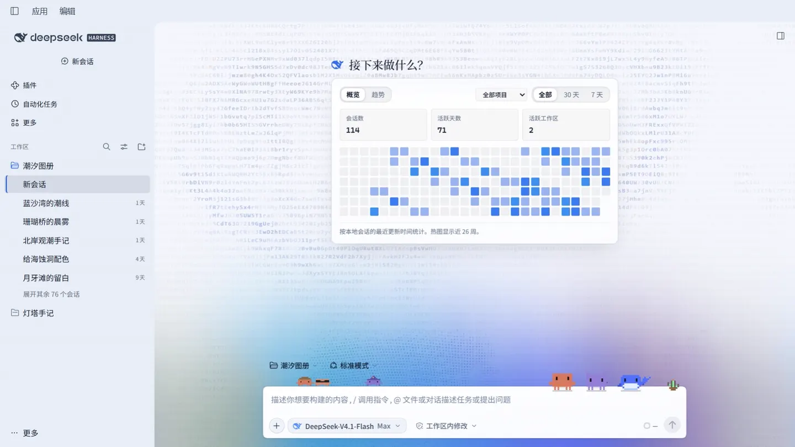
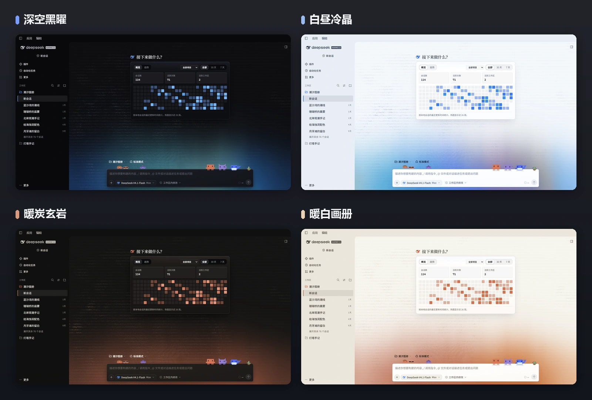
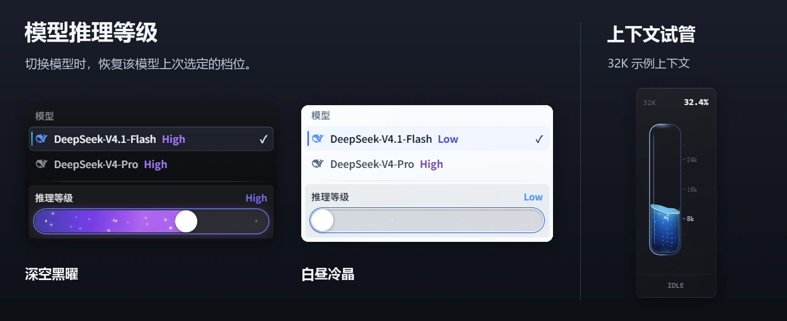
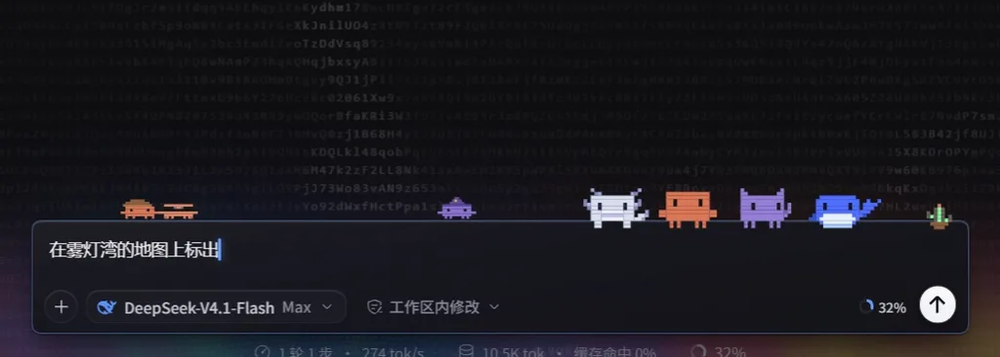
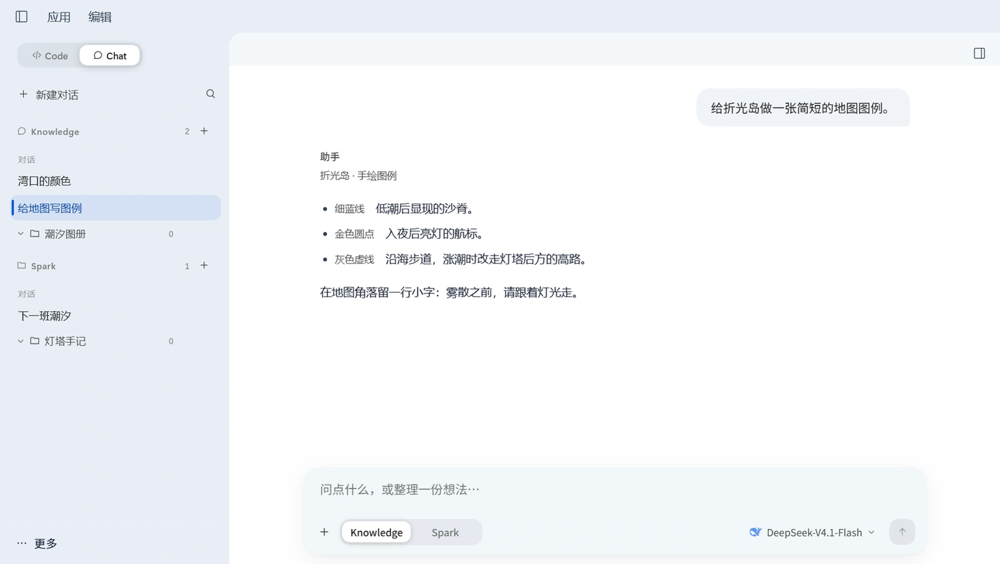

# Obsidian-Prism4DSH

**黑曜棱镜的 DeepSeek Harness 桌面移植版。** 本项目独立维护，原项目 Obsidian Prism 由 RMvdesi 与上游贡献者开发。本版已在 Windows 版 DeepSeek Harness **0.2.2-rc.5** 上验证。[Antigravity 原项目](https://github.com/RMvdesi/obsidian-prism) · [v0.3.4 版本说明与性能对比](CHANGELOG.md)

<picture>
  <source media="(prefers-color-scheme: dark)" srcset="assets/previews/hero-dark.webp">
  <source media="(prefers-color-scheme: light)" srcset="assets/previews/hero-light.webp">
  
</picture>

画面录自 DeepSeek Harness 桌面端，「潮汐图册」「灯塔手记」两个工作区及其中的会话和模型回复均为虚构示例。

## 安装与升级

- 在 GitHub 的 **Releases → v0.3.4** 下载 `Obsidian-Prism4DSH-0.3.4.zip`。压缩包内含可直接加载的插件、对应源码和构建脚本。插件标识沿用 `dsh-obsidian-prism`，升级后可继续读取原有设置。
- 首次安装时，将 ZIP 解压到固定位置，打开 DSH 的 **设置 → 插件 → 添加插件**，输入解压后包含 `package.json` 的 `dsh-obsidian-prism` 文件夹的完整路径。完成后按应用提示重启。
- 如果原来安装的是另一个固定目录的副本，可以退出 DSH 后把新版解压到该插件目录，保留同一目录名称，再启动 DSH。

## 功能预览

### 四套界面配色

同一张活动热图分别采用深空黑曜、白昼冷晶、暖炭玄岩和暖白画册四套配色，方便对照侧栏、卡片和底部光晕。

### 推理等级与上下文试管

在模型菜单拖动滑块，插件会记住该模型的推理等级，点开输入框右侧的占用环即可查看上下文水位。

### 字心涟漪

连续输入两组文字时，每圈波纹都从该组文字的中心向外扩散，越过输入框后在字符底纹中显现。

### 桌宠选角与输入框

在选角舞台点亮伙伴，它们就会站上输入框，并在切换会话时留在原位。

### Chat 对话模式（Beta）

在「Beta 内容」开启 Chat 模式后，即可从侧栏切换到独立对话空间，图中打开的是虚构会话「给地图写图例」。

## 操作

| 位置 | 操作 |
| --- | --- |
| **切换会话** | 打开另一段会话记录时，正文在 180 毫秒内轻轻淡入。桌宠留在原位，底纹继续起伏。关闭「弹簧与消息动效」或开启系统「减少动态效果」时，正文立即显示。 |
| **打字涟漪** | 波源位于刚输入的字下方。一次确认一个词或粘贴一段文字时，以这次新增文字的可见范围中心为波源。涟漪先被输入框遮住，越过边缘后在周围的字符底纹中显现。快速连续输入会合并相邻波纹，并沿用当前页面的字符波纹开关、浓度和目标帧率。 |
| **新会话** | DeepSeek 鲸鱼标记、「接下来做什么？」和活动卡片在当前对话区内整体水平居中。概览显示本地会话数、活跃天数与工作区数，可按工作区或日期筛选。热图按最近更新时间着色，悬停或使用方向键可查看日期与会话数。趋势页展示按天统计的更新。底部可选择工作区、模型并直接发出第一条消息。 |
| **Chat 对话模式（Beta）** | 默认关闭。在 **设置 → 通用 → Obsidian Prism · 黑曜棱镜 → Beta 内容** 开启「Chat 对话模式」后，侧栏顶部出现 Code / Chat。切到 Chat 后，Knowledge 用于文字对话，Spark 可以导入文本文件。侧栏可建文件夹、搜索对话、拖动归类。Enter 发送，Shift + Enter 换行。关闭此功能后回到工程会话，之前的 Chat 记录会保留。 |
| **输入框** | 指针沿边移动可看到反光，聚焦后可以看到平滑光标。像素伙伴停在输入框上沿，可拖动、叠放。在同一主窗口切换会话和新建会话时，沿用当前伙伴和位置。点发送键旁的上下文占用环打开物理水柱，点击水面可产生波动。容量随当前模型变化。 |
| **模型键** | 单击输入框的模型名打开列表。有可用推理档位时，列表下方固定显示「推理等级」。拖动白色圆柄并松开，或聚焦滑条后按方向键，即可将档位应用到当前 DSH 会话。切换到另一款有档位的模型后可直接继续调整。首次还未选定模型时，滑条标题显示它将应用到的模型。适配器提供 Orchestrator 模型时显示切工水晶。 |
| **外观与桌宠** | 打开 DSH **设置 → 通用**，展开 **Obsidian Prism · 黑曜棱镜**。可以切换四套配色、强调色、圆角、光效强度和场景预设，也可导出、导入设置。进入“交互 → 打开桌宠选角舞台”，点击角色或名牌调整阵容。 |
| **底部极光** | 在“外观”选择「极夜琉纱」或「幽邃光晕」，并从「静谧、均衡、绚丽」中选择亮度和覆盖范围。默认极夜琉纱、均衡。在深空黑曜配色下使用「跟随模型」可看到两种材质的原生色带。指定强调色或使用暖色配色时，已有色彩选择优先。 |
| **推理档位记忆** | “实用模块”中的「跨模型记住推理档位」默认开启。通过底部模型列表或 DSH 的 `/model` 切回模型时，恢复这个提供方下该模型上次选定的有效档位。原会话打开时保留会话自身的选择。没有有效记录时使用 DSH 的默认档位。 |
| **壁纸** | 在“Beta 内容”中选本机图片或视频。视频随系统减少动态效果设置暂停。 |
| **目标刷新帧率** | 在 **设置 → 通用 → Obsidian Prism · 黑曜棱镜 → 外观** 选择 60、120、180 FPS 或原生满帧。默认 180 FPS。切换立即生效，重启后保留。新会话与对话页在前台静置时，底部光晕和字符纹理都按所选档位刷新，起伏速度放慢。任务呼吸和点击涟漪的节奏独立于刷新帧率。原生满帧跟随桌面窗口的刷新节奏，实际帧率取决于屏幕和渲染负载。 |
| **字符波纹** | “外观”中的「首页字符波纹」可单独开关。「对话页字符波纹」可选关闭、微光、标准、鲜明。首次安装默认首页开启、对话微光。升级时沿用原档位，原来关闭字符光场的用户两页都保持关闭。关闭其中一页的字符纹理后，该页的底部光晕仍可独立显示。 |
| **任务呼吸** | 思考、等待工具和输出回答时，整个中央对话区的字符底纹会渐渐染上当前配色，随呼吸加深、变淡。文字在底纹上方，思考与回答所在行也能看到背景。任务结束后，底纹平滑回到静置时的慢速起伏。点击空白处仍可叠加涟漪。 |
| **输入与滚动** | 在“交互”中分别开关平滑打字光标和输入框紧凑排版。向上阅读历史后，点回到底部可选择高速惯性或原生瞬移。惯性滑动时可用滚轮中断。 |
| **代码字体与连字** | 在“交互”选择系统默认、JetBrains Mono、Cascadia Code 或 SF Mono / Consolas。支持连字的本机字体可把多字符运算符显示为连字，复制时仍是原字符。 |
| **会话正文** | 普通右键打开棱镜菜单，可旁聊、打开大纲或文件检视台，选中文字后还可翻译。Shift + 右键保留宿主菜单。可在“交互”中关闭「会话直触右键菜单」。把指针停在侧栏当前会话的大纲图标上，可筛选并直接跳到某轮提问。Alt + ↑ / ↓ 跳到相邻提问。长代码块可收起。 |
| **原生右侧栏** | 单击正文里的 HTTP(S) 链接或会话页眉的“打开资源检视台”。网页面板提供“打开原链接”。选择本机图片、音频、视频、PDF、代码或 diff 可在同一侧栏预览。 |
| **思考、标题与旁聊** | 展开思考后点“译为中文”。设置可切换双语对照和沉浸译文，可随时查看原文或重译，也可开启自动翻译。翻译页可取当前标题，查看译文后手动写回。旁聊历史和主会话独立。 |

## 数据与宿主差异

- Code 继续使用 DSH 的会话、编辑器、模型目录和权限控件。试管沿用 DSH 上下文压力读数。Studio 活动日历只统计每个已有会话的**最近一次更新**。本版没有用量拆分、配额预测或账单明细。
- Chat、旁聊和翻译使用当前 DSH 的模型提供方。发起请求时，相应对话内容和选中的附件内容会发送给该提供方。Chat 历史、文件夹和设置保存在当前客户端。Spark 文件夹用于归类对话；附件由用户选取或拖入。工程文件修改、工具执行和权限审批仍在 Code 中进行。
- 模型列表及可用推理档位取决于适配器。上游演示中的 Gemini、Claude、Orchestrator 名称不会自动添加到你的账号。第三方网站能否在右栏显示取决于其嵌入策略。
- DSH 的窗口边框、原生工作区命令和权限提示由宿主绘制。

## 开发与来源

在插件目录运行 `node scripts/build.mjs` 可从 `src/`、`vendor/` 重建 `lib/client.js`，无需下载构建依赖。服务端通过 Cordis 加载 `src/host.js`。官方光场、试管、桌宠、星尘与水晶与酒馆等渲染器随插件提供。DSH 绑定、设置页和 Chat 工作区代码在 `src/`。部分上游选择器在构建时映射到 DSH，来源和保留声明见 `NOTICE` 与 `THIRD_PARTY_NOTICES.md`。

原作者为 **RMvdesi** 与上游贡献者。本版移植更新于 2026-11-26，以 **GPL-3.0-only** 分发。[上游极光材质版本](https://github.com/RMvdesi/obsidian-prism/tree/41cc4817bf6da79688236f42905450bdf93f40b1) · [其他组件的移植基线](https://github.com/RMvdesi/obsidian-prism/tree/2e2768025a54c534d5337791ebd0667ab5a6e192)

本仓库和 ZIP 均附有上游许可、原作者署名和第三方 MIT 声明。再分发时请保留这些文件、插件「关于」页里的署名，以及修改内容和日期；分发构建产物时请同时提供对应的完整源码与构建脚本。本移植由社区独立发布。[LICENSE](LICENSE) · [NOTICE](NOTICE) · [第三方声明](THIRD_PARTY_NOTICES.md)
